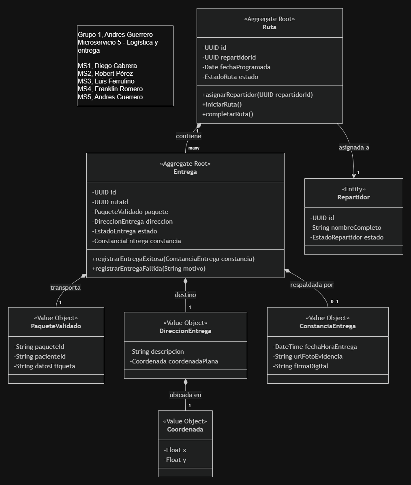

## Domain Model



## Documentación

| Documento | Contenido |
| --- | --- |
| [docs/running-locally.md](docs/running-locally.md) | **Guía paso a paso** para levantar ms5 junto con toda la plataforma (gateway, Consul, RabbitMQ, catálogo, identity, ms4) en tu máquina. **Empieza aquí.** |
| [docs/connectivity-and-messaging.md](docs/connectivity-and-messaging.md) | Cómo funciona la integración: outbox transaccional, publicación a RabbitMQ, registro en Consul, ruteo del gateway, contratos en el shared kernel, troubleshooting. |
| [docs/TESTING.md](docs/TESTING.md) | Suite de tests. |
| [docs/domain-model.md](docs/domain-model.md) | Modelo de dominio. |

## Ejecución en la plataforma (recomendado)

ms5 se ejecuta normalmente dentro del stack de la plataforma (`nur-tricenter-local`), que incluye
`nurtricenter.compose.yml` de este repo. Resumen (detalle en [docs/running-locally.md](docs/running-locally.md)):

1. Configura el token de GitHub (`read:packages`) para el feed privado de los shared kernels:
   `NUGET_USERNAME` / `NUGET_TOKEN` como variables de entorno de usuario.
2. Clona los repos hermanos con `nur-tricenter-local\scripts\setup-project.ps1`.
3. Si esta carpeta no se llama `nurtricenter-logistics-and-delivery`, define `NURTRICENTER_REPO_DIR` con su nombre.
4. Copia `.env.example` a `.env` y coloca la cadena de conexión de Neon (`.env` no se versiona).
5. Ejecuta `powershell -ExecutionPolicy Bypass -File ..\nur-tricenter-local\scripts\start-stack.ps1`.
6. Prueba: `POST http://localhost:15005/api/nurtricenter/v1/couriers` con `{"fullName":"Jane Doe"}`.

## Ejecución con Docker (ms5 solo, sin plataforma)

### Requisitos

- [Docker Desktop](https://www.docker.com/products/docker-desktop/) instalado y en ejecución.
- `NUGET_USERNAME` / `NUGET_TOKEN` definidos: la restauración usa el feed privado de Nur-tricenter
  (paquete `Nur.Tricenter.Integration`).

### 1. Construir la imagen

```powershell
docker build --secret id=nuget_username,env=NUGET_USERNAME --secret id=nuget_token,env=NUGET_TOKEN -t aguerreroc/nurtricenter-ms5:0.2.0 .
```

| Parte                 | Significado                                                                                                                                                       |
| --------------------- | ----------------------------------------------------------------------------------------------------------------------------------------------------------------- |
| `docker build`        | Comando de Docker que construye una imagen a partir del `Dockerfile` encontrado en el contexto de compilación.                                                    |
| `--secret id=...,env=...` | Pasa las credenciales del feed NuGet como secretos de BuildKit: solo existen durante el `dotnet restore` y **nunca** quedan en una capa de la imagen.          |
| `-t aguerreroc/nurtricenter-ms5:0.2.0` | Etiqueta la imagen resultante para poder referenciarla más adelante. La imagen contiene la API y el worker (`/app/worker`).                      |
| `.`                   | El contexto de compilación: el directorio actual. Su contenido se envía al demonio de Docker y se usa como directorio de trabajo para los pasos del `Dockerfile`. |

### 2. Ejecutar el contenedor

En PowerShell, ejecuta el contenedor pasando las variables de entorno requeridas (reemplaza la cadena de conexión de la base de datos con la cadena correcta que se encuentra en el .env):

```powershell
docker run --rm -p 8080:8080 `
    -e "ConnectionStrings__DefaultConnection=Host={HOST}; Database=neondb; Username=neondb_owner; Password={PASSWORD}; SSL Mode=VerifyFull; Channel Binding=Require;" `
    -e "ClinicService__BaseUrl=https://763708cb-6809-4a65-be56-fe140385a461.mock.pstmn.io" `
    -e "branchCoordinates__latitude=-17.768853725548713" `
    -e "branchCoordinates__longitude=-63.18276022365929" `
    aguerreroc/nurtricenter-ms5:0.2.0
```

| Parte               | Significado                                                                                                                                                                                                                                         |
| ------------------- | --------------------------------------------------------------------------------------------------------------------------------------------------------------------------------------------------------------------------------------------------- |
| `docker run`        | Crea e inicia un nuevo contenedor a partir de la imagen indicada.                                                                                                                                                                                   |
| `--rm`              | Elimina automáticamente el contenedor cuando se detiene, para que no queden contenedores acumulados.                                                                                                                                                |
| `-p 8080:8080`      | Publica el puerto `8080` del contenedor en el puerto `8080` del host (`host:contenedor`).                                                                                                                                                           |
| `` ` ``             | Carácter de continuación de línea de PowerShell: permite dividir el comando en varias líneas.                                                                                                                                                       |
| `-e "NOMBRE=valor"` | Establece una variable de entorno dentro del contenedor. El `__` (doble guion bajo) se mapea a `:` en la configuración de .NET, por lo que `ConnectionStrings__DefaultConnection` establece la configuración `ConnectionStrings:DefaultConnection`. |
| `aguerreroc/nurtricenter-ms5:0.2.0` | La imagen construida en el paso anterior.                                                                                                                                                                                           |

Variables de entorno:

| Variable                                 | Propósito                                                                                           |
| ---------------------------------------- | --------------------------------------------------------------------------------------------------- |
| `ConnectionStrings__DefaultConnection`   | Cadena de conexión a PostgreSQL (Neon) usada por la capa de persistencia.                           |
| `ClinicService__BaseUrl`                 | URL base del servicio externo de clínicas con el que se integra la API.                             |
| `branchCoordinates__latitude`            | Latitud de la sucursal usada como punto de partida de las entregas.                                 |
| `branchCoordinates__longitude`           | Longitud de la sucursal usada como punto de partida de las entregas.                                |
| `HttpsRedirection__Enabled`              | `false` detrás del gateway (TLS termina upstream); `true` solo si este proceso es el borde TLS.     |
| `ServiceRegistration__ServiceDiscoveryAddress` | URL del agente Consul (ej. `http://host.docker.internal:8500`). En blanco = sin registro.      |
| `ServiceRegistration__ServiceName`       | Nombre con el que el gateway rutea (`/api/{nombre}/...`). La plataforma usa `nurtricenter`.         |
| `ServiceRegistration__ServiceId`         | Identificador único de esta instancia (obligatorio si hay más de una réplica).                      |
| `ServiceRegistration__Host` / `__Port`   | Dirección y puerto que el gateway usa para llegar a esta instancia.                                 |
| `RabbitMqSettings__Host`                 | Broker RabbitMQ (solo el worker). El puerto debe ser 5672 — la librería ignora `__Port`.            |
| `RabbitMqSettings__UserName` / `__Password` / `__VirtualHost` | Credenciales del broker (solo el worker).                                               |

Una vez en ejecución, verifica el health check del contenedor en <http://localhost:8080/health>.

### Para ejecutar con Docker Compose

El repositorio también incluye un `docker-compose.yml` con dos servicios: `api` y `worker`
(el worker publica los eventos de dominio al broker RabbitMQ mediante el outbox transaccional).
Las variables de entorno van inline en el archivo; edita el placeholder
`ConnectionStrings__DefaultConnection` (y `RabbitMqSettings__Host`) antes de levantar los
servicios, sin commitear esos valores. La imagen debe construirse con el `Dockerfile` actualizado, que publica ambos proyectos:

```powershell
docker build --secret id=nuget_username,env=NUGET_USERNAME --secret id=nuget_token,env=NUGET_TOKEN -t aguerreroc/nurtricenter-ms5:0.2.0 .
docker compose up
```

Para detener y eliminar los contenedores:

```powershell
docker compose down
```

### Integración con el gateway (Consul + RabbitMQ)

El servicio se registra en Consul cuando `ServiceRegistration__ServiceDiscoveryAddress` tiene
valor, y el gateway compartido (YARP + Consul) lo expone en `/api/nurtricenter/*` reescribiendo a
`/api/*` — por eso todos los endpoints están versionados (`/api/v1/...`). Consul sondea
`/health`, que incluye un chequeo de PostgreSQL solo cuando el registro está habilitado; si la
base cae, `/health` responde 503 y Consul deja de anunciar la instancia.

Los eventos de dominio se publican a exchanges fanout de RabbitMQ (uno por evento, ver
`contracts/NurtricenterExchanges.cs`); la cola `nurtricenter.default` acumula el historial
completo y nunca se consume. Las colas por consumidor (p. ej. `ms4.route-completed`) las declara
cada microservicio consumidor en `rabbitmq-definitions.json` de `nur-tricenter-local`.

Los contratos de integración viven en el shared kernel (`Nur.Tricenter.Integration`, namespace
`Nur.Tricenter.Integration.Messages.Logistics`), para que publicador y consumidores compilen
contra los mismos tipos. Cambiar un contrato = PR al repo `nur-tricenter-shared-kernels` + subir
la versión del paquete aquí.

Guía completa del flujo y de cómo probarlo: [docs/connectivity-and-messaging.md](docs/connectivity-and-messaging.md).
Guía paso a paso para ejecutarlo localmente: [docs/running-locally.md](docs/running-locally.md).
