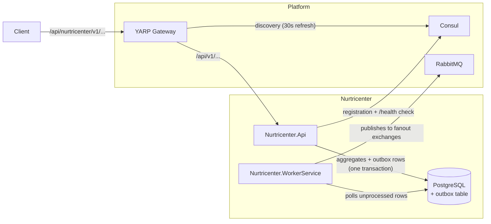
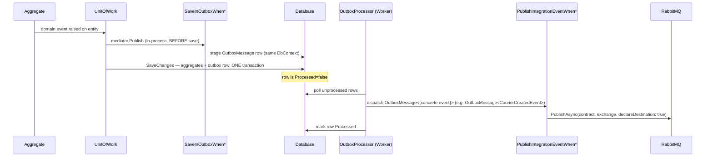
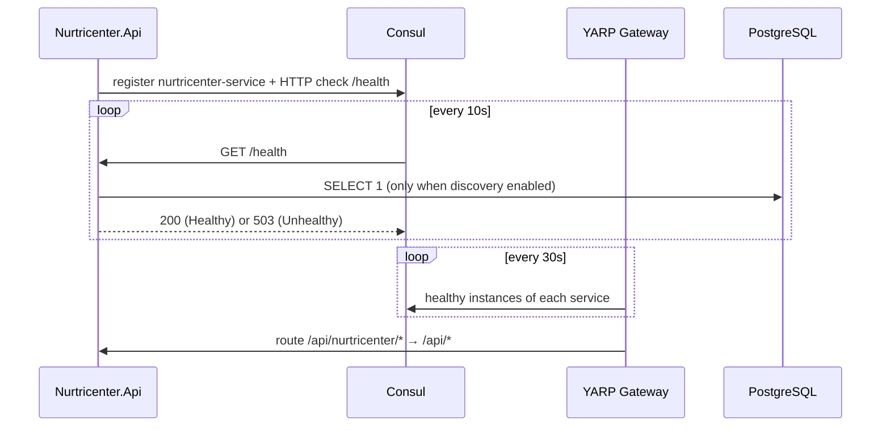

# Connectivity & Messaging — Flow and Testing Guide

This document explains how Nurtricenter (ms5) connects to the rest of the platform: how it is
discovered and routed to through the shared API gateway, and how its domain events reach other
microservices through RabbitMQ. It covers the implementation flow end-to-end and how to test it.

> **Just want to run it?** Follow [running-locally.md](running-locally.md). It's a step-by-step
> guide to bringing up ms5 with the whole platform (gateway, Consul, RabbitMQ, catalog, identity,
> ms4) on your machine.

---

## 1. Overview

The platform connects microservices in two independent ways:

| Mechanism | Direction | Purpose |
|---|---|---|
| **Consul + YARP gateway** | inbound HTTP | The shared gateway (`nur-tricenter-api-gateway`) discovers healthy service instances in Consul and routes `/api/{service}/*` to them. No static route table exists — registration IS routing. |
| **RabbitMQ fanout exchanges** | outbound events | Every domain fact the service produces is published as an integration event through a transactional outbox, so no event can be lost or invented around a crash. |

Both mechanisms are **opt-in through configuration** and degrade gracefully: with no Consul
address configured the service simply runs unreachable through the gateway; with no broker the
worker logs warnings and retries — nothing crashes on startup.



---

## 2. Flow 1 — From domain event to RabbitMQ (transactional outbox)

The design goal: **an event must be published if and only if its aggregate change was saved**.
A crash between "save" and "publish" must never lose or duplicate the business fact beyond
what a consumer can handle (at-least-once semantics).

### 2.1 The domain event is raised

Aggregates raise events through the `Joseco.DDD.Core` base types — e.g.
`Courier` raises `CourierCreatedEvent` in its constructor, `Route.CompleteDelivery` raises
`DeliveryCompletedEvent`. Events accumulate on the entity in memory; nothing happens yet.

### 2.2 The unit of work drains events BEFORE saving

`Nurtricenter.Infrastructure.Data.UnitOfWork.CommitAsync`:

1. Collects the pending domain events from all tracked entities (`ChangeTracker.Entries<Entity>()`).
2. Publishes each one through **MediatR, in-process** — this is where the
   `SaveInOutboxWhen*` handlers run and stage `OutboxMessage<DomainEvent>` rows into the
   *same DbContext*.
3. **Then** calls `SaveChangesAsync` — so aggregates and outbox rows are written in **one
   database transaction**.

> Draining before saving is the whole trick: if the handler published straight to RabbitMQ
> before the commit, a failed save would have already emitted an event for a change that never
> happened. If it published after the commit, a crash in between would lose the event. Staging
> a row in the same transaction makes both impossible.

The drain runs in rounds (max 10) so an in-process handler that mutates an aggregate and raises
a follow-up event (e.g. completing the last delivery completes the route, raising
`RouteCompletedEvent`) is collected in the next round. A re-entrancy guard makes a nested
`CommitAsync` (like the one inside `CompleteRouteWhenAllDeliveriesCompletedHandler`) a no-op:
its mutations persist through the outer save.

### 2.3 The worker turns rows into messages

`Nurtricenter.WorkerService` runs the library's `OutboxProcessor<DomainEvent>` as a background
service:

1. Polls rows where `Processed = false`, ordered by creation time.
2. Re-wraps each row as a **new** `OutboxMessage<{runtime event type}>` — e.g.
   `OutboxMessage<CourierCreatedEvent>` — and publishes it through MediatR. Only `Content` is
   copied: the stored `CorrelationId` is dropped, and the original trace instead travels as the
   parent of the processor's `Joseco.Outbox` activity (the worker listens to that source so
   `OutboxCorrelation` can recover it).
3. The `PublishIntegrationEventWhen*` handlers (registered **only** in the worker) are each
   registered for that concrete type, map the domain event to its **integration contract** and
   publish it to the contract's exchange. A handler registered for
   `OutboxMessage<DomainEvent>` would **never run** (generic classes are not variant) while the
   row is still marked processed — `OutboxProcessorDispatchTests` guards this.
4. The library marks the row `Processed` after a successful dispatch. If publishing throws,
   the row stays unprocessed and is retried on the next poll — that is the at-least-once
   guarantee; consumers must be idempotent.



### 2.4 The message envelope

Every published message extends `Joseco.Communication.External.Contracts.Message.IntegrationMessage`:

| Field | Source |
|---|---|
| `Id`, `CreatedAt` | set by the library |
| `CorrelationId` | stamped by `OutboxTracingService` from `Activity.Current.TraceId` when the row is staged — the same id ties the HTTP request, the DB row, the worker's logs and the message together |
| `Source` | `"nurtricenter"` (const in each publish handler) |
| `EventType` | stable discriminator (`"Delivery.Completed"`, …) — consumers switch on this, never on the CLR type |

### 2.5 Broker topology

`DefaultQueueRegistrar` (worker) declares, idempotently and with a 10s retry loop:

- One **fanout exchange per event** (non-durable, non-auto-delete — flags MUST match what the
  Joseco 1.1.0 publisher declares, or RabbitMQ answers `406 PRECONDITION_FAILED`).
- One queue, **`nurtricenter.default`** (durable), bound to all 10 exchanges and **never
  consumed** — it is the complete history record of everything this service publishes.

Per-consumer queues are created by the consuming microservices themselves against these
exchanges. All exchange names live in `contracts/NurtricenterExchanges.cs`.

---

## 3. Flow 2 — Consul registration and gateway routing

### 3.1 Self-registration

When `ServiceRegistration:ServiceDiscoveryAddress` is set, the API registers a
`ServiceRegistration` hosted service:

- On **start**: registers this instance with its own HTTP check on
  `http://{host}:{port}/health` (probe interval 10s, timeout 5s,
  `DeregisterCriticalServiceAfter` 30s). Registration is retried 3 times with exponential
  backoff (500ms → 1s) and **never throws** — a Consul outage only degrades discovery.
- On **stop**: deregisters; if that fails, Consul evicts the instance after 30s anyway.
- The advertised port prefers the configured `Port` and falls back to the port Kestrel
  actually bound (`ServerAddressesPortResolver`).

### 3.2 Health-gated discovery

`/health` always exists (the gateway and Consul probe it), but the **postgres check is
registered only when discovery is enabled** — one predicate
(`IsServiceDiscoveryEnabled()`) gates both, so they can never drift apart:

- DB down → `/health` returns **503** → Consul marks the instance critical → the gateway
  drops the route on its next refresh (30s).
- No discovery config → zero checks → `/health` reports `Healthy` (honest: nothing external
  to report on), and integration tests never touch a real database.

The response body is the structured writer in `Nurtricenter.Api/Utils/HealthReportWriter.cs`:
`{ success, message, data: { status, totalDurationMilliseconds, entries: [...] } }`.

### 3.3 Gateway routing

The shared gateway (YARP + Consul) exposes every healthy service at
`/api/{serviceName}/*`. It strips `/api/{serviceName}` and prepends `/api`, so:

```
Client:  POST /api/nurtricenter/v1/couriers
         → gateway rewrites to /api/v1/couriers → Nurtricenter.Api
```

**That is why every endpoint is versioned** (`/api/v1/...`): the rewrite needs the shared
`/api` prefix on the upstream path. The 3 formerly unversioned routes were normalized to
`/api/v1/couriers`, `/api/v1/routes` and `/api/v1/packages/deliveries` for exactly this reason.

Also note `HttpsRedirection` is **off** behind the gateway (TLS terminates upstream) — it is a
config toggle (`HttpsRedirection:Enabled`), enabled only for local https runs.



---

## 4. Event catalog

| Domain event | Integration contract (shared kernel) | Exchange | `EventType` |
|---|---|---|---|
| `CourierCreatedEvent` | `CourierCreated` | `courier-created` | `Courier.Created` |
| `CourierStatusChangedEvent` | `CourierStatusChanged` | `courier-status-changed` | `Courier.StatusChanged` |
| `RouteCreatedEvent` | `RouteCreated` | `route-created` | `Route.Created` |
| `CourierAssignedToRouteEvent` | `CourierAssignedToRoute` | `courier-assigned-to-route` | `Route.CourierAssigned` |
| `DeliveryAddedToRouteEvent` | `DeliveryAddedToRoute` | `delivery-added-to-route` | `Route.DeliveryAdded` |
| `RouteStartedEvent` | `RouteStarted` | `route-started` | `Route.Started` |
| `RouteCompletedEvent` | `RouteCompleted` | `route-completed` | `Route.Completed` |
| `RouteCancelledEvent` | `RouteCancelled` | `route-cancelled` | `Route.Cancelled` |
| `DeliveryCompletedEvent` | `DeliveryCompleted` | `delivery-completed` | `Delivery.Completed` |
| `DeliveryFailedEvent` | `DeliveryFailed` | `delivery-failed` | `Delivery.Failed` |

Adding an event means: a constant in `NurtricenterExchanges`, a contract in the shared kernel, a `SaveInOutboxWhen*`
handler, a `PublishIntegrationEventWhen*` handler and a line in `All`. The test suite fails the
build if any of these steps is forgotten (see §5.1).

### 4.1 Shared kernel (the canonical contracts)

The platform keeps every cross-service message in the shared kernel, so publisher and consumer
compile against the same type. The ten contracts above live in
`nur-tricenter-shared-kernels/nur-tricenter-integration/Messages/Logistics/`
(namespace `Nur.Tricenter.Integration.Messages.Logistics`). ms5 consumes them as the package
`Nur.Tricenter.Integration` **1.1.0** (the version every platform service pins), referenced from `contracts/Nurtricenter.Contracts.csproj`.
That project keeps only `NurtricenterExchanges`, because the kernel's naming test forbids domain
words in non-message types.

The package comes from the private Nur-tricenter GitHub Packages feed (`NuGet.config` at the
repo root). Restoring needs a classic GitHub token with `read:packages` in the environment:

```powershell
[Environment]::SetEnvironmentVariable("NUGET_USERNAME", "<github-user>", "User")
[Environment]::SetEnvironmentVariable("NUGET_TOKEN",    "<token>",       "User")
```

A Docker build passes the same values as BuildKit secrets, which never reach an image layer:

```powershell
docker build --secret id=nuget_username,env=NUGET_USERNAME --secret id=nuget_token,env=NUGET_TOKEN -t aguerreroc/nurtricenter-ms5:0.2.0 .
```

To change a contract:
1. Open a PR to the kernel that edits the record and bumps `<Version>` in `Directory.Build.props`.
2. Once that version is published, bump the `PackageReference` here.

### 4.2 Running inside the platform stack

`nurtricenter.compose.yml` (repo root) is the platform variant: `nur-tricenter-local` includes it,
bind-mounts `bin/Debug/net10.0` of the API and the worker, registers the API in Consul as
`nurtricenter`. It uses ms5's own Neon database, **not** the platform Postgres. The connection
string is read from a gitignored `.env` at the repo root; copy `.env.example` to create it. See the
`nur-tricenter-local` README, section "ms5".

---

## 5. Testing

### 5.1 Automated tests

```bash
dotnet test src/Nurtricenter.Api/Nurtricenter.Api.slnx
```

Restoring needs the private feed token (`NUGET_USERNAME` / `NUGET_TOKEN`, see §4.1). The suite
(273 tests) includes connectivity-specific guards on top of the domain/use-case tests:

| Test | What it guards |
|---|---|
| `ServiceDiscovery/ServiceRegistrationTests` | registration payload + own `/health` check, 30s eviction, deregister on stop, 3 retries without throwing, bound-port fallback, extension no-op without config |
| `Infrastructure/UnitOfWorkTests` | aggregate + outbox row saved in one commit, re-entrancy guard (`CommitAsync` called twice does not re-enter), tracker cleared on failed save, no duplicate outbox rows |
| `Infrastructure/Outbox/*` | staging/update/unprocessed query (InMemory), trace stamping from `Activity.Current`, `CorrelationId` preservation |
| `Domain/Events/DomainEventOutboxSerializationTests` | every domain event round-trips through the outbox's Newtonsoft serializer with payload intact; **no domain event exposes a public parameterless constructor** (which would make Newtonsoft build empty events) |
| `Contracts/NurtricenterExchangesTests` | every publisher destination is a declared exchange and vice versa, no duplicates |
| `DomainEvents/OutboxChainCoverageTests` | every domain event has both its `SaveInOutboxWhen*` and `PublishIntegrationEventWhen*` handler |
| `DomainEvents/PublishIntegrationEventHandlersTests` | mapping, destination exchange, `declareDestination: true`, `CorrelationId`/`Source`, unrelated events ignored |
| `WorkerService/*` | `RabbitMqSettings` required, publisher registration, publish handlers only exist in the worker host, queue bound to exactly the 10 registry exchanges |
| `WorkerService/OutboxProcessorDispatchTests` | runs the **real** Joseco `OutboxProcessor` with the real DI wiring: a staged row is published to its exchange and marked processed (guards the `OutboxMessage<{concrete event}>` dispatch contract) |
| `Integration/ServiceDiscoveryGatingTests` | the test host reads discovery as **disabled** |

**Hermetic integration tests:** `IntegrationTestWebAppFactory` boots the real host, which loads
the git-ignored `appsettings.Development.json` — the file that points at a *real* Consul. The
factory blanks `ServiceRegistration:ServiceDiscoveryAddress` through an in-memory configuration
source (appended last, so it wins), which turns off Consul registration, the postgres health
check and everything external in one stroke.

### 5.2 Manual end-to-end test

The quickest end-to-end check is the full platform stack: [running-locally.md §4–§5](running-locally.md#4-start-the-stack)
walks through it, from starting the stack to the message showing up in RabbitMQ. The steps
below are the **debugging variant**: the API and worker run from your IDE against the platform's
Consul and RabbitMQ, so you can set breakpoints anywhere in the chain.

#### Prerequisites

1. **Database schema**: the outbox table (`outbox."outboxMessage"`) must exist in Neon. The
   migration that creates it is already in the repo; apply pending migrations by hand from
   `src/Nurtricenter.Infrastructure`:

   ```bash
   dotnet ef database update --startup-project ../Nurtricenter.Api
   ```

2. **Platform infrastructure** running (Consul, RabbitMQ, Postgres), with the ms5 containers
   stopped so they don't compete with your local processes:

   ```powershell
   powershell -ExecutionPolicy Bypass -File "..\nur-tricenter-local\scripts\start-stack.ps1"
   docker stop nur-tricenter-nurtricenter-api nur-tricenter-nurtricenter-workerservice
   ```

   (Or, without the gateway and other services, run only
   `..\nur-tricenter-local\scripts\start-infrastructure.ps1`.)

   > RabbitMQ **must** be reachable on host port **5672**: the Joseco 1.1.0 library builds its
   > connection from Host/User/Password only and silently ignores `RabbitMqSettings:Port`.

#### Step 1 — Run the API

The local `appsettings.Development.json` points at `http://localhost:8500` and advertises
`Host: host.docker.internal` — Consul runs **inside a container**, so it must probe the API
through the Docker host alias; `localhost` would be the Consul container itself and the check
would stay critical.

```bash
dotnet run --project src/Nurtricenter.Api/Nurtricenter.Api.csproj --launch-profile http
```

Expected:
- Log line: `Registered <ServiceId> (<ServiceName>) in Consul at host.docker.internal with an HTTP check on http://host.docker.internal:5036/health.`
  Registration runs once Kestrel has bound its port (`ApplicationStarted`), not before.
- If the check stays critical, Kestrel may only be listening on loopback: run with
  `ASPNETCORE_URLS=http://0.0.0.0:5036` so the Docker host alias can reach it.
- Consul UI (<http://localhost:8500>) shows your `ServiceName` with a **passing** check. Use
  `nurtricenter` as the name to keep the same gateway path the platform uses.
- `curl http://localhost:5036/health` returns:

  ```json
  {"success":true,"message":"Healthy","data":{"status":"Healthy","totalDurationMilliseconds":…,"entries":[{"name":"postgres","status":"Healthy",…}]}}
  ```

#### Step 2 — Trigger an event

```bash
curl -X POST http://localhost:5036/api/v1/couriers \
     -H "Content-Type: application/json" \
     -d '{"fullName":"E2E Courier"}'
```

Expected: `201 Created`. Then inspect the database (Neon console or psql): the `Couriers` row
exists and `outbox."outboxMessage"` contains **one unprocessed row** whose `content` JSON is the
full `CourierCreatedEvent` (with `type` discriminator) and whose `traceId`/`correlationId` are
filled from the HTTP request.

#### Step 3 — Run the worker

The worker reads `src/Nurtricenter.WorkerService/appsettings.Development.json` (git-ignored; copy
`appsettings.Development.template.json` and fill in the connection string). Its launch profile
sets `DOTNET_ENVIRONMENT=Development` so that file is loaded.

```bash
dotnet run --project src/Nurtricenter.WorkerService/Nurtricenter.WorkerService.csproj
```

Expected:
- Log: `Queue nurtricenter.default is declared and bound to 10 exchange(s): courier-created, …`
- RabbitMQ management UI (<http://localhost:15672>, guest/guest): 10 fanout exchanges;
  queue `nurtricenter.default` durable, bound to all 10, with **depth 1**.
- Inspect the message ("Get messages" in the UI): `EventType: "Courier.Created"`,
  `Source: "nurtricenter"`, `CorrelationId` filled, full payload.
- The outbox row's `processed` flag is now `true` and `processedOn` is set.

#### Step 4 — Route through the gateway

Call the gateway (host port `15005`) instead of the API directly:

```powershell
Invoke-RestMethod -Method Post -Uri http://localhost:15005/api/nurtricenter/v1/couriers `
  -ContentType 'application/json' -Body '{"fullName":"Via Gateway"}'
```

Expected: the same `201`. The gateway discovered `nurtricenter` in Consul and rewrote
`/api/nurtricenter/v1/couriers` → `/api/v1/couriers` upstream. The gateway log shows
`Proxying to http://<host>:<port>/api/v1/couriers`.

- A **GET** on that URL (e.g. from a browser) returns `405 Method Not Allowed`. The route works;
  the endpoint is POST-only. The only ms5 GET is `/v1/couriers/{id}/route/today`.
- A service that isn't registered, or is unhealthy, gets `404` from the gateway: no route exists.
  The gateway refreshes from Consul every 30 s.
- ms5 endpoints are anonymous. Catalog, identity and ms4 require a JWT from identity; see
  [running-locally.md §5.5](running-locally.md#55-another-service-through-the-gateway-login-needed).

### 5.3 Failure-path checks

| Scenario | Expected behaviour |
|---|---|
| Stop Consul while the API runs | API keeps serving; log warnings about failed (re)registration; gateway keeps the last known-good route until the instance is evicted |
| Stop PostgreSQL | `/health` returns 503 with the `postgres` entry Unhealthy; Consul marks the instance critical; gateway drops the route within 30s |
| Stop RabbitMQ before starting the worker | Worker boots; `DefaultQueueRegistrar` retries every 10s; outbox rows stay unprocessed and are published once the broker returns |
| Kill the worker right after a commit | Rows stay `processed=false`; restarting the worker publishes them (at-least-once) |

---

## 6. Configuration reference

| Key (env-var form) | Used by | Default | Meaning |
|---|---|---|---|
| `ServiceRegistration__ServiceDiscoveryAddress` | API | *(blank)* | Consul agent URL. **Master switch**: blank = no registration, no postgres health check |
| `ServiceRegistration__ServiceName` | API | `nurtricenter-service` | Name the gateway routes by (platform uses `nurtricenter`) |
| `ServiceRegistration__ServiceId` | API | = ServiceName | Unique per replica |
| `ServiceRegistration__Host` | API | `localhost` | Address the **gateway** uses to reach this instance |
| `ServiceRegistration__Port` | API | bound port | Port the gateway uses |
| `HttpsRedirection__Enabled` | API | `false` | `true` only when this process is the TLS edge (local https profile) |
| `RabbitMqSettings__Host` | Worker | — | Broker host; **must be reachable on 5672** |
| `RabbitMqSettings__UserName` / `__Password` / `__VirtualHost` | Worker | — | Broker credentials (guest/guest/`/` locally) |
| `RabbitMqSettings__MaxRetryAttempts` / `__RetryBaseDelayMilliseconds` | Worker | 3 / 500 | Consumer-side retry policy (used by services that consume; this service only produces) |
| `ConnectionStrings__DefaultConnection` | API + Worker | — | PostgreSQL connection string (ms5's Neon database) |
| `NUGET_USERNAME` / `NUGET_TOKEN` | build / restore | — | GitHub user + classic token (`read:packages`) for the private Nur-tricenter feed |
| `NURTRICENTER_REPO_DIR` | platform compose + `start-stack` | `nurtricenter-logistics-and-delivery` | Name of the ms5 folder next to `nur-tricenter-local` |

Tracked `appsettings.json` files deliberately contain **no** connection strings, broker
credentials or `ServiceRegistration` section. Those live in gitignored places:

| Where ms5 runs | Configuration comes from |
|---|---|
| Platform stack (`nurtricenter.compose.yml`) | `environment:` in the compose file, plus `ConnectionStrings__DefaultConnection` from `.env` in the repo root |
| `dotnet run` / IDE / `dotnet ef` | `src/*/appsettings.Development.json` |
| Standalone image (`docker-compose.yml`) | `environment:` in that file (fill in the `CHANGE_ME` placeholders locally) |

---

## 7. Troubleshooting

| Symptom | Likely cause |
|---|---|
| `406 PRECONDITION_FAILED - inequivalent arg 'durable'` | An exchange was declared with different flags elsewhere. Exchanges must be `fanout` + non-durable + non-auto-delete to match the Joseco 1.1.0 publisher |
| Worker can't connect even though RabbitMQ is up | Broker not on host port 5672 (the library ignores `RabbitMqSettings:Port`) |
| Consul shows no service | `ServiceRegistration__ServiceDiscoveryAddress` blank/malformed (malformed throws at startup); or no port resolvable (check `Port` / launch profile) |
| `/health` returns 503 in development | Postgres unreachable — this is the intended gate (Consul then stops advertising the instance) |
| Outbox rows become `processed = true` but no message reaches RabbitMQ | A publish handler is registered for the wrong notification type. It must handle `OutboxMessage<{concrete event}>`, which is what Joseco's processor dispatches |
| Published messages have empty payloads | A domain event gained a public parameterless constructor — Newtonsoft deserializes through it. The serialization guard test fails first |
| `TypeLoadException` mentioning MediatR 12 at startup | Joseco's `AddOutbox<T>()` was called — it is incompatible with MediatR 14; outbox services must be registered manually (see `Nurtricenter.Infrastructure.DependencyInjection.AddOutboxServices`) |
| API returns 404 behind the gateway | Route not versioned (`/api/v1/...`) or service unhealthy/not registered in Consul (the gateway refreshes every 30 s) |
| `405` through the gateway | The route works; the endpoint doesn't accept that HTTP method (e.g. a browser GET on a POST-only URL) |
| `Could not resolve the port to advertise` at API startup | No `ServiceRegistration:Port` and no bound port yet. Registration is deferred to `ApplicationStarted` for this reason; set `Port` explicitly in containers |
| Consul check stays critical for a locally run API | Consul runs in a container: advertise `Host: host.docker.internal` and listen on `0.0.0.0`, not `localhost` |
| `relation "outbox.outboxMessage" does not exist` in the worker | The connection string points at a database without ms5's schema (e.g. `.env` missing, so not Neon) |
| `NU1102` for a freshly published `Nur.Tricenter.*` version | NuGet's HTTP cache predates the release: `dotnet restore --no-http-cache` |
| Docker build fails restoring `Nur.Tricenter.*` | Build without the feed secrets: add `--secret id=nuget_username,env=NUGET_USERNAME --secret id=nuget_token,env=NUGET_TOKEN` |

More symptoms from running the whole platform are in [running-locally.md §9](running-locally.md#9-troubleshooting).

---

## 8. Key code locations

| Concern | Path |
|---|---|
| Consul registration | `src/Nurtricenter.Infrastructure/ServiceDiscovery/` |
| Outbox + unit of work | `src/Nurtricenter.Infrastructure/Data/{UnitOfWork,EfCoreOutboxService}.cs`, `Observability/OutboxTracingService.cs` |
| Outbox handlers | `src/Nurtricenter.Application/DomainEvents/` |
| Worker host | `src/Nurtricenter.WorkerService/` |
| Integration contracts | shared kernel: `nur-tricenter-shared-kernels/nur-tricenter-integration/Messages/Logistics/` (package `Nur.Tricenter.Integration`) |
| Exchange registry | `contracts/NurtricenterExchanges.cs` |
| Platform compose (ms5 part) | `nurtricenter.compose.yml` (+ `.env`, from `.env.example`) |
| Feed configuration | `NuGet.config`, Dockerfile (BuildKit secrets) |
| Health writer + wiring | `src/Nurtricenter.Api/{Utils/HealthReportWriter.cs, DependencyInjection.cs}` |
| Integration test factory (hermetic gating) | `src/Nurtricenter.Test/Integration/IntegrationTestWebAppFactory.cs` |
